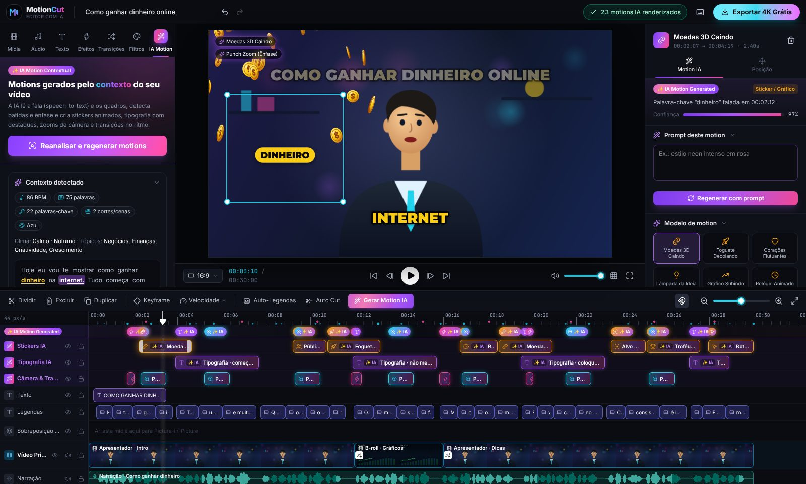

# MotionCut — editor de vídeo web com IA Motion contextual

Editor de vídeo gratuito que roda no navegador, com interface inspirada no CapCut. O diferencial é o motor **IA Motion**: ele analisa a fala e os quadros do vídeo e gera sozinho stickers animados, tipografia cinética, zooms de câmera e transições sincronizadas com a música.



```bash
npm install
npm run dev        # http://localhost:5173
npm run build      # build de produção em dist/
```

Stack: **React 19 + Vite**, **Tailwind CSS v4**, **Zustand** (estado global), **Lucide-React** (ícones). O render usa Canvas 2D, o áudio usa WebAudio e a exportação usa MediaRecorder. Nenhum servidor é necessário.

O projeto abre com uma demonstração de 30 s (apresentador, B-roll, narração e música lo-fi). Para ver o motor de IA, abra a aba **IA Motion** e clique em **Analisar Contexto do Vídeo**.

---

## 1. Interface (layout estilo CapCut)

| Área | O que tem |
| --- | --- |
| **Barra superior** | Logo, título editável, Desfazer/Refazer, **indicador do Render de IA** (etapa, % e fila de render) e o botão **Exportar 4K Grátis** |
| **Painel esquerdo** | Abas Mídia, Áudio, Texto, Efeitos, Transições, Filtros e **IA Motion** (aba especial). Grades com busca, categorias e arrastar e soltar para a timeline |
| **Player central** | Preview em canvas com Play/Pause, quadro anterior/próximo, início/fim, tempo atual/duração (mm:ss:quadros), proporção **16:9, 9:16, 1:1 e 4:5**, guias de área segura, tela cheia. Clique num elemento do preview para selecioná-lo; arraste para mover e use os cantos para mudar a escala |
| **Inspetor (direita)** | As abas mudam conforme o item selecionado: **Vídeo** (escala, posição, rotação, opacidade, mistura, remoção de fundo, ajustes de cor, filtro, efeitos, transição), **Áudio** (volume, fade in/out, mudo, redução de ruído), **Velocidade**, **Animações**, **Texto** e **IA**. Sem seleção, mostra as configurações do projeto |
| **Timeline multicamadas** | Régua interativa com playhead e marcas de batidas (ciano) e ênfase (rosa). Faixa dedicada com os badges **✨ IA Motion Generated**. Trilhas: Stickers IA, Tipografia IA, Câmera e Transições IA, Texto, Legendas, Sobreposição (PIP), Vídeo Principal (magnética), Narração, Música e SFX. Na barra de ferramentas: **Dividir, Excluir, Duplicar, Keyframe, Velocidade, Auto-Legendas, Auto Cut, Gerar Motion IA**, snap e zoom |

Na timeline dá para arrastar clipes entre trilhas compatíveis, aparar pelas bordas, usar snap (no playhead e nas bordas de outros clipes), fazer zoom com Ctrl+roda, mutar, ocultar ou bloquear trilhas e soltar mídia vinda da biblioteca.

## 2. IA Motion contextual

Fluxo: **Analisar Contexto do Vídeo** → pipeline com 6 etapas e progresso → motions criados automaticamente nas trilhas de IA.

1. **Áudio**: decodifica os áudios usados (WebAudio) e calcula o envelope de energia.
2. **Speech-to-text**: obtém a transcrição com o tempo de cada palavra (veja "O que é real e o que é simulado").
3. **Visão**: amostra os quadros do vídeo principal a 2 fps e mede brilho, saturação, cor dominante, centro de interesse e mudanças de cena (por histograma).
4. **Ritmo**: detecta onsets/batidas e estima o BPM por autocorrelação; encontra os picos de ênfase da voz.
5. **Contexto**: um léxico pt-BR liga palavras a visuais. Exemplos: *dinheiro* → moedas 3D caindo, *foguete* → foguete decolando, *ideia* → lâmpada, *sucesso* → troféu com confete, *tempo* → relógio, *coração* → corações, *foco* → alvo, *segue* → botão seguir. A mesma etapa identifica os tópicos e o clima do vídeo.
6. **Geração**:
   - **Stickers/gráficos** posicionados longe do rosto (usando o centro de interesse), com rótulo da palavra-chave.
   - **Typography Motion** com as palavras-chave em outra cor (Kinetic Pop, Slide Stack, Glitch Type, Minimal Line, Letreiro Neon).
   - **Transições dinâmicas** (flash, glitch, zoom blur, varredura de luz, pulso RGB) nos cortes e nas batidas fortes.
   - **Câmera automática**: punch-zoom nos picos de ênfase, tremor em palavras de impacto e push-in suave no início das cenas.
   - **SFX sincronizados** (caixa registradora, whoosh, ding…) opcionais.

A interface tem:

- Uma **faixa de badges brilhantes** na timeline que mostra onde cada motion foi aplicado. Clicar num badge seleciona o motion e leva o playhead até ele.
- Um **prompt editável**, por exemplo *"Gere um motion estilo minimalista futurista para a fala atual"*. O parser entende estilo (combinável), escopo (*fala atual*, *vídeo inteiro*, *clipe selecionado*), intensidade (*sutil*, *intenso*), cor (*rosa*, *dourado*…), elementos pedidos (*moedas*, *foguete*…) e exclusões (*sem zoom*, *sem som*…).
- Uma lista dos motions gerados, com motivo, nível de confiança e um botão para ligar/desligar cada um.
- No inspetor de cada motion: troca de modelo, estilo, cor, intensidade, texto e destaques, e regeneração com um prompt próprio.

## 3. Recursos clonados do CapCut

- **Legendas automáticas** estilo TikTok/Reels com realce palavra por palavra (Pop, Karaokê, Caixa, Cor) e escolha de quantas palavras por legenda.
- **Auto Cut**: remove as pausas da fala com ripple em todas as trilhas. A música de fundo não é cortada.
- **Remoção de fundo**: **Chroma Key** real (distância no plano CbCr, com suavização e remoção de reflexo; o asset *Green Screen* serve para testar) e **Smart Cutout IA**.
- **Velocidade**: velocidade constante de 0,1x a 10x e **curvas de velocidade** (Montagem, **Montanha-russa**, **Bate-estaca**, Herói, Bala, Salto, Flash In/Out) com editor de pontos arrastáveis. O remapeamento vale para o vídeo e para o áudio (playbackRate automatizado).
- **Biblioteca de efeitos**: glitch, separação RGB, VHS, pixelizar, zoom pulsante, tremor, zoom radial, flash, estroboscópio, desfoque, glow, granulado, filme antigo, vinheta, vazamento de luz, bokeh e espelho.
- **13 transições**, **16 filtros** com intensidade, **animações** de entrada, saída e loop, **keyframes** (posição, escala, rotação e opacidade), modos de mistura no PIP, estilos de texto e modelos animados.
- **Exportação real** em 720p, 1080p, 2K ou **4K**, a 24, 30 ou 60 fps, em MP4 ou WebM, com o áudio mixado e sem marca d'água.

## 4. Arquitetura

```
src/
├── store/useEditorStore.js   # Estado global Zustand: projeto, trilhas, clipes, playback,
│                             # seleção, histórico (undo/redo), UI e ações da IA
├── engine/
│   ├── renderer.js           # Compositor: camadas → câmera IA → motions → texto → pós-FX
│   ├── motionTemplates.js    # Stickers, tipografia, câmera e transições da IA (procedurais)
│   ├── motionStyles.js       # Estilos (Vibrante, Minimalista, Futurista, Neon, Retrô…)
│   ├── fx.js                 # Glitch, RGB split, zoom blur, grão, vinheta, chroma key…
│   ├── textRenderer.js       # Layout de texto rico (realce por palavra, contorno, neon)
│   ├── demoSources.js        # "Vídeos" procedurais da demo (apresentador, B-rolls)
│   ├── audioEngine.js        # WebAudio: agendamento, fades, velocidade, redução de ruído
│   ├── playback.js           # Relógio de reprodução (áudio como referência)
│   ├── mediaPool.js          # <video>/ das mídias importadas
│   ├── exporter.js           # captureStream + MediaRecorder (até 4K)
│   └── demoVoice.js          # Voz sintética (TTS) da narração demo
├── ai/
│   ├── contextAnalyzer.js    # Orquestra o pipeline "Analisar Contexto"
│   ├── audioAnalysis.js      # Envelope, onsets, BPM, ênfase, VAD
│   ├── frameAnalysis.js      # Brilho, cor, foco, mudança de cena
│   ├── transcriber.js        # STT (demo / alinhamento de roteiro / provedor plugável)
│   ├── lexicon.js            # Palavra → motion (pt-BR)
│   ├── promptParser.js       # Prompt livre → parâmetros estruturados
│   ├── motionGenerator.js    # Gera os clipes de motion e SFX
│   └── captionGenerator.js   # Divide a transcrição em legendas
├── audio/synth.js            # Músicas e SFX sintetizados (com batidas reais)
├── lib/                      # Catálogos, curvas de velocidade, keyframes, fábrica de clipes…
└── components/               # layout/, left/, preview/, inspector/, timeline/, modals/, ui/
```

**Estado global.** Todas as atualizações são imutáveis, então o histórico guarda só referências. Ajustes contínuos, como arrastar um slider ou mover um clipe, entram como **um único passo** no histórico. O store fica em `window.MotionCut.store` para depuração ou automação, por exemplo `MotionCut.store.getState().runAIAnalysis()`.

**Render.** `renderFrame(ctx, W, H, state, time)` é uma função pura do estado e do tempo. O preview e a exportação usam a mesma função, então o arquivo exportado sai igual ao que se vê na tela.

## 5. O que é real e o que é simulado

| Componente | Situação |
| --- | --- |
| Análise de áudio (BPM, batidas, ênfase, VAD), análise de quadros, chroma key, curvas de velocidade, mixagem e exportação | **Reais**, rodam no navegador. Na demo, o BPM detectado sai 86 para uma música de 85 BPM |
| Speech-to-text | A narração demo traz os tempos das palavras (simula a saída de um Whisper). Em vídeos importados, cole o roteiro e ele é **alinhado aos trechos de voz detectados**. Para STT automático, registre um provedor com `setCustomSttProvider(fn)` em `src/ai/transcriber.js` (Whisper API, transformers.js etc.), devolvendo `{ words: [{ w, start, end }] }` |
| Interpretação do prompt | Parser local em pt-BR. Para usar um LLM, troque `parsePrompt` por uma chamada que devolva o mesmo formato |
| Smart Cutout em vídeos importados | Máscara de segmentação suave (aproximação). Nos assets demo, a máscara é exata. Para recorte de verdade, plugue MediaPipe Selfie Segmentation em `processBackground` (`src/engine/renderer.js`) |
| Voz da narração demo | Síntese de fala do navegador durante a reprodução. Não entra no arquivo exportado |
| Exportação | É feita em **tempo real**: mantenha a aba visível. H.264 depende do navegador; o Chromium sem codec proprietário grava VP9 dentro de MP4 ou WebM. Em 4K, a fluidez depende da máquina |

## 6. Atalhos

`Espaço` reproduzir/pausar · `←/→` um quadro (com `Shift`, 1 s) · `S` ou `Ctrl+B` dividir · `Del` excluir · `Ctrl+D` duplicar · `K` keyframe · `Ctrl+Z` / `Ctrl+Shift+Z` desfazer/refazer · `+`/`−` zoom · `G` gerar Motion IA · `Esc` limpar seleção.
